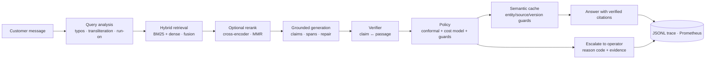
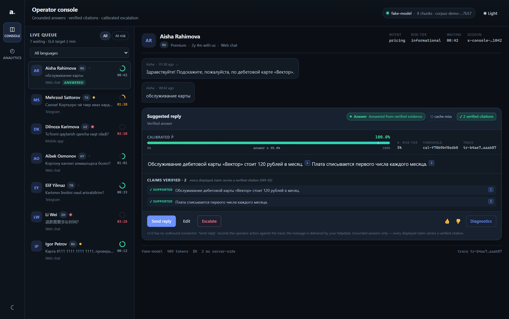
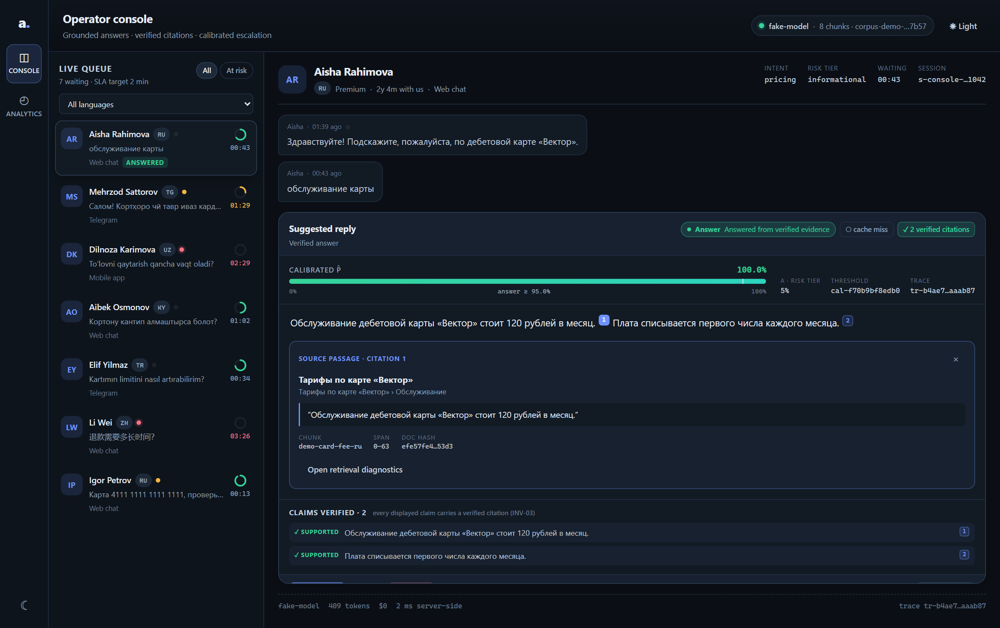
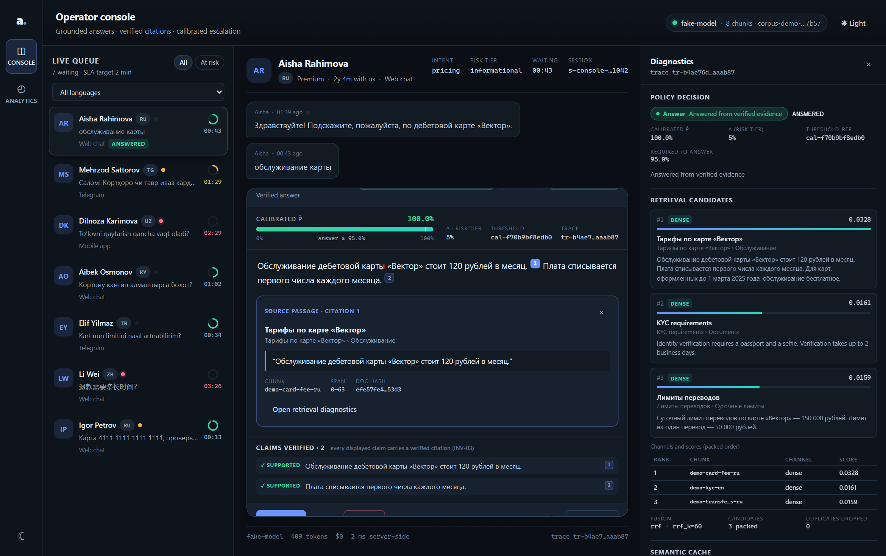
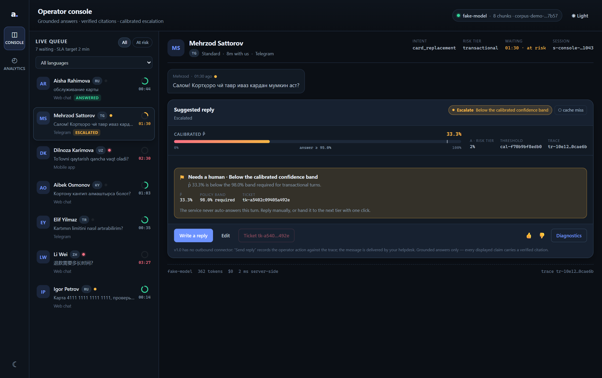
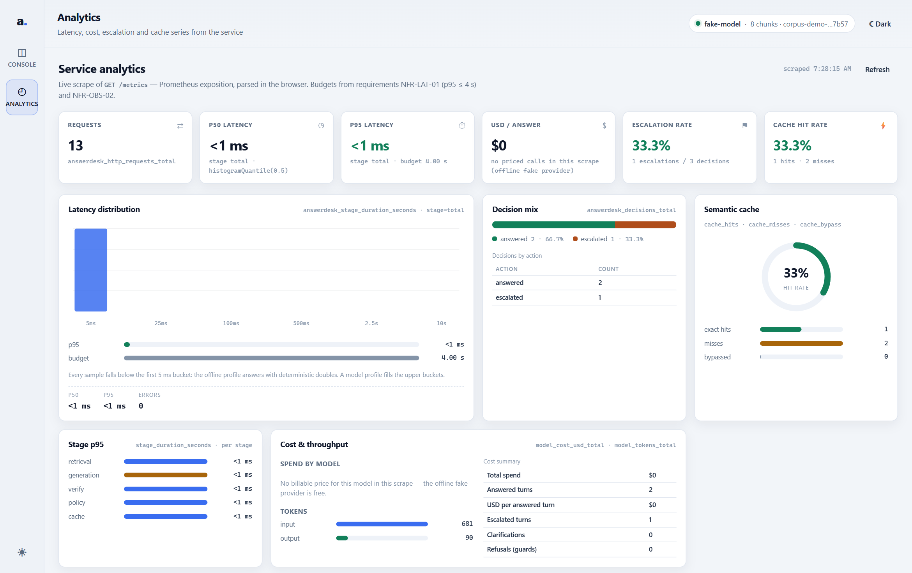

# answerdesk

**Multilingual customer-support RAG that shows its work: verified citations, a calibrated
answer/escalate decision, and numbers that come with confidence intervals and committed
artifacts.**

A reference implementation, not a demo. Every displayed sentence is backed by a retrieved
passage and checked by a verifier; the system abstains instead of guessing; the retrieval,
answer-quality, escalation, cache, latency and cost measurements are reproducible from one
command on a laptop — no Docker, no vector database, no API key required for the offline path.

`Python 3.11–3.13` · `MIT (code) · CC0-1.0 (synthetic corpus)` · `Windows / Linux / macOS` ·
`local-first, API-optional (OpenAI-compatible: vLLM, llama.cpp, Ollama)`

> **Honest status (v0.1.0).** The pipeline, service, console and evaluation harness work
> end-to-end and offline. The first live study produced a **negative result on risk control**:
> with the shipped overlap-based confidence signal, realised risk on answered turns was 22.3%
> against a 5% target. That result is published in [`docs/results.md`](docs/results.md) and
> nothing in this repository claims otherwise. What *is* demonstrated: grounded answers with
> verified citations, must-escalate recall of 1.00 (0 false negatives / 24 unsafe cases), a
> reproducible measurement chain, and retrieval quality that improves comprehension on public
> benchmarks in four of five languages.

---

## Why this exists

Open-source RAG demos are easy to build and hard to trust. Three failures matter in customer
support, and most projects have all three:

1. **Citations are decoration.** A marker under the answer is not evidence. Here citations are
   span-level, must resolve to a passage that was actually in the context, and are checked by a
   verifier against the claim; unsupported claims are dropped or the turn is escalated
   (`INV-02`, `INV-03`, [`docs/generation.md`](docs/generation.md)).
2. **The system does not know when it does not know.** A threshold picked by eye is not a policy.
   Here a split-conformal quantile and a cost model decide answer / clarify / escalate, with both
   error directions measured (must-escalate recall *and* false-escalation rate).
3. **The numbers are asserted, not measured.** Here every table in [`docs/results.md`](docs/results.md)
   is generated from committed artifacts by [`scripts/build-results.py`](scripts/build-results.py),
   with frozen hashed splits, document-level leakage checks, paired bootstrap and McNemar tests,
   and a judge from a different model family than the generator.

The repository is also opinionated about what it will **not** claim: no human-judge κ, no
production traffic, no SOTA ranking. See [Limitations](#limitations-what-does-not-generalize).

---

## Architecture



The full component diagram (module boundaries, ownership, data flow) is in
[`docs/architecture.md`](docs/architecture.md); a rendered copy lives at
[`docs/assets/architecture.svg`](docs/assets/architecture.svg). The design decisions behind the
boundaries are 13 ADRs in [`docs/design-decisions.md`](docs/design-decisions.md).

Six locales are first-class: **ru, uz, tg, ky, tr, zh**. The generator answers in the query's
language; the corpus, golden sets and every reported metric are per-language.

---

## Quickstart — offline, no API key

Prerequisites: [uv](https://docs.astral.sh/uv/) and Python 3.11+ (uv can fetch Python itself).
Nothing else: no Docker, no database server, no model weights for this path.

```bash
git clone <your-fork> answerdesk && cd answerdesk
uv sync --extra dev --extra api        # base + test tooling + the service extra
uv run answerdesk demo --smoke         # whole offline loop in one command (~10 s)
```

`demo --smoke` is the shortest honest path: it builds the corpus, builds the index, answers a
question with deterministic doubles, fits the calibration artifact, starts the service and
probes `/healthz`, then writes `reports/demo/summary.json` with every step, its duration and the
versions it ran against. It exits 0 only when all steps passed, needs no key and no network, and
skips the service step (saying so) when the `api` extra is absent.

The same steps one at a time, if you want to watch each one:

```bash
uv run answerdesk ingest --demo           # build the 6-locale synthetic corpus (~8 s)
uv run answerdesk index --demo            # BM25 + exact dense index (~1 s)
uv run answerdesk ask --fake "Сколько стоит обслуживание карты?"
uv run answerdesk eval --synthetic --provider fake --report reports/offline-smoke
```

The last command **rewrites** `reports/offline-smoke/` (report.md, metrics.json, turns.jsonl,
cells.csv and the four figures) in place: the directory is a build product of the synthetic
study, not a hand-edited document, so a reviewer comparing two runs should diff it rather than
assume the committed copy is frozen. Point `--report` somewhere else when both must be kept.

```text
```

`ask` prints the answer with numbered citations, the decision and its reason code, and the token
cost. With deterministic doubles it looks like this:

```text
Q: Сколько стоит обслуживание карты?
A: Обслуживание дебетовой карты «Вектор» стоит 120 рублей в месяц. [1] Плата списывается первого числа каждого месяца. [2]
Citations:
  [1] Тарифы по карте «Вектор» — Тарифы по карте «Вектор» > Обслуживание (demo-card-fee-ru) chars 0-63
      “Обслуживание дебетовой карты «Вектор» стоит 120 рублей в месяц.”
  [2] Тарифы по карте «Вектор» — Тарифы по карте «Вектор» > Обслуживание (demo-card-fee-ru) chars 64-111
      “Плата списывается первого числа каждого месяца.”
Decision: answer (ANSWERED); language=ru; evidence_score=0.940; repaired=False; dropped=0
Usage: model=fake-model input=314 output=45 usd=0.00000000 prompt=grounded-answer-1.0.0 verifier=lexical-verifier-1.0.0
```

The one-command version of the whole offline loop (corpus → index → question → decision →
service health check) is `uv run answerdesk demo --smoke` above; `scripts/demo.ps1` is the
PowerShell wrapper that additionally runs the calibration + eval smoke steps for a reviewer's
transcript:

```powershell
pwsh -File scripts/demo.ps1
```

> **Windows with a system proxy.** `httpx` reads the Windows proxy settings; a `socks4` proxy
> URL that it cannot drive fails at client construction. The shipped code handles that: the
> hosted embedder/reranker build their client through a proxy-tolerant factory that ignores an
> unusable ambient proxy with a warning, and the `--healthcheck` probe talks to loopback with
> `trust_env=False`. The scripts still set `NO_PROXY` for the loopback hosts, and so should you
> when running the CLI by hand: `$env:NO_PROXY='*'`. The test suite does not depend on it — the
> proxy tests set and clear `NO_PROXY` themselves, so `pytest` is green either way (t50).

## Run it against a real model

Any OpenAI-compatible endpoint works with **no code change**: hosted APIs (OpenAI, DeepSeek,
OpenRouter) or a local server (vLLM, llama.cpp, Ollama). Provider choice is configuration — the
preset table is [`src/answerdesk/config.py`](src/answerdesk/config.py), documented in
[`docs/generation.md`](docs/generation.md).

```bash
cp .env.example .env                      # then edit, or export variables instead
export OPENAI_API_KEY=sk-...              # or DEEPSEEK_API_KEY / OPENROUTER_API_KEY
uv run answerdesk config check --profile api     # validates the preset and shows it redacted
uv run answerdesk ask "Сколько идёт возврат средств по карте?" --profile api
```

Local, nothing leaves the machine:

```bash
uv sync --extra local                     # torch + sentence-transformers (CPU is fine)
ollama serve && ollama pull qwen3:8b      # or: vllm serve Qwen/Qwen3-8B-Instruct --port 8000
uv run answerdesk --profile local config check
uv run answerdesk --profile local ask "Сколько идёт возврат средств по карте?"
```

Windows + NVIDIA CUDA wheels for the local extra are documented in
[`docs/architecture.md`](docs/architecture.md) §11; CPU-only works everywhere.

## Operator console

The React console turns the decision into something a human can supervise: the queue, the
suggested reply with clickable citation chips, the calibrated score against the answer band, the
reason code, and a diagnostics drawer with retrieval candidates, fusion parameters, cache status,
per-stage latency and cost.



| | |
|---|---|
|  |  |
| Citation opens the exact source passage | Diagnostics explain the decision |
|  |  |
| Escalation carries a reason code and a ticket | Analytics read the live Prometheus exposition |

```bash
cd web
npm ci
npm run dev          # http://localhost:5173 — proxies /v1, /metrics, /healthz to the service
npm run test         # 61 component/integration tests, no network
npm run build        # tsc --noEmit && vite build
```

Start the service in another shell first:

```bash
$env:NO_PROXY='*'; uv run --extra api answerdesk serve --fake --port 8765
```

Mock mode (no backend at all): open `http://localhost:5173/?mock=1`, or build with
`VITE_USE_MOCK=true`. Playwright screenshots of all six screens are reproducible with
`npm run screenshots` (see [`web/README.md`](web/README.md)).

---

## What is inside

| Layer | What it does | Read more |
|---|---|---|
| **Ingestion** | PDF/DOCX/HTML/Markdown loaders, structure-first chunking (headings, tables, FAQ pairs never split), MinHash dedup, canonical date/amount tokens, seeded multilingual generator | [`docs/ingestion.md`](docs/ingestion.md) |
| **Retrieval** | BM25 + dense hybrid, RRF and convex-combination fusion, query analysis for typos/transliteration/run-on text, optional cross-encoder rerank and MMR | [`docs/retrieval.md`](docs/retrieval.md) |
| **Generation** | One provider layer for API and local servers, strict JSON claims, span-level citations, one repair pass, language agreement | [`docs/generation.md`](docs/generation.md) |
| **Policy** | Split-conformal quantile with the `⌈(n+1)(1−α)⌉` correction, three-way cost rule, PII and prompt-injection guards, coverage monitor | [`docs/escalation.md`](docs/escalation.md) |
| **Cache** | Exact + semantic lookup with entity/source-document/version guards, negative caching, calibrated wrong-hit budget | [`docs/cache.md`](docs/cache.md) |
| **Service** | FastAPI + SSE (`retrieval → tokens → citations → decision → done`), SQLite sessions and idempotency, JSONL traces, Prometheus metrics, protected admin ingestion | [`docs/api.md`](docs/api.md), [`docs/ops.md`](docs/ops.md) |
| **Console** | React + Vite + TypeScript operator UI, dark/light, MSW mock mode, a11y | [`web/README.md`](web/README.md) |
| **Evaluation** | Frozen golden set with adversarial companion sets, retrieval/answer/escalation/cache metrics, bootstrap + McNemar + Wilson, judge calibration protocol, ablations | [`docs/eval-methodology.md`](docs/eval-methodology.md) |
| **Robustness & load** | Fuzzing findings and fixes, hostile-input handling, concurrency and leak checks | [`docs/robustness.md`](docs/robustness.md), [`docs/load.md`](docs/load.md) |

### Design highlights

- **Hybrid retrieval with measurable fusion.** RRF ships as the label-free default; tuned convex
  combination is the documented path, fitted on the dev split only (never on test). The ablation in
  [`docs/results.md`](docs/results.md) shows what each arm actually buys *on this corpus* — and it
  is honest about BM25 dominating a lexically easy synthetic corpus.
- **Grounded citations, verified.** Claim → citation span → verbatim quote → `doc_hash`, plus a
  deterministic numeric guard: a number or date in a claim must appear in a cited passage.
- **Calibrated escalation machinery.** Split-conformal quantile, cost-sensitive three-way rule
  (`answer` / `clarify` / `escalate`), guard precedence (`PII`/injection → high-risk intent →
  conformity → cost band), and a gate that is stated before it is measured: risk control holds only
  if the Wilson upper bound of realised risk is ≤ α. In the first live study it did not hold, and
  that is reported as the headline.
- **Calibrated cache, not a cosine threshold.** Hits must pass entity equality, source-document and
  version guards, and are re-validated before display; the wrong-hit budget is measured on an
  adversarial near-miss replay set.
- **Universal provider layer.** One OpenAI-compatible client; presets differ only in defaults, so
  switching between a hosted API and a local server is a config edit (and local presets need no key).
- **Deterministic offline evaluation.** No network, no key, no GPU: tests install a socket guard
  that fails any outbound connection, and `scripts/ci-offline.ps1` runs the same gate as CI.

---

## Results

All numbers below come from [`docs/results.md`](docs/results.md) and its committed artifacts under
`reports/`. They describe this reference stack **on a synthetic corpus** (810 documents, 7,229
chunks, 3,240 grounded queries in six languages) unless marked external. CIs are 95%.

### Retrieval ablation (internal, n=240 cases; 40 per language)

| arm | recall_any@10 | nDCG@10 | MRR@10 | mean latency |
|---|---|---|---|---|
| `bm25` | 0.996 [0.988, 1.000] | 0.934 [0.915, 0.952] | 0.984 | 1.3 ms |
| `dense` (hashing-64 by default, bge-m3 optional) | 0.950 [0.921, 0.975] | 0.672 [0.632, 0.706] | 0.820 | 1017.7 ms |
| `rrf@60` (hybrid) | 0.992 [0.979, 1.000] | 0.856 [0.826, 0.881] | 0.957 | 2.3 ms |
| `cc@0.75` (hybrid, tuned α) | 0.975 [0.954, 0.992] | 0.809 [0.774, 0.840] | 0.914 | 2.4 ms |

Paired bootstrap on `recall_any@10`: `bm25 − dense` = **+0.0458** [+0.0208, +0.0750], McNemar
p=0.001 — BM25 wins; `bm25 − rrf@60` = +0.0042 [0.0000, +0.0125], p=1.0 — **no claim**. On this
corpus the text is lexically easy, so hybrid retrieval has nothing to add; the ablation is the
evidence, and the limitation is stated rather than hidden. The reranker arm is reported separately
(n=80) in [`docs/results.md`](docs/results.md).

### Answer quality and escalation (primary arm: `qwen3.6-35b-a3b-noreason` generator, cross-family judge)

| metric | value (95% CI, n) | reading |
|---|---|---|
| groundedness (judged, claim support) | 0.908 [0.858, 0.950] (n=141) | 9 in 10 displayed claims judged supported |
| rubric score (1–5, pass ≥ 4) | 4.692 [4.576, 4.790] (n=141) | judged, κ caveat |
| citation recall (ALCE-style) | 0.211 [0.189, 0.233] (n=141) | **the weak spot**: many statements have no citation that fully supports them |
| citation precision | 0.671 [0.610, 0.727] (n=141) | two thirds of citations support their claim |
| language agreement | 0.986 [0.952, 0.996] (n=148) | answers in the query language |
| auto-answer coverage | 0.841 [0.780, 0.888] (n=176) | 84% of turns answered without a human |
| must-escalate recall | 1.000 [0.862, 1.000] (n=24) | 0 false negatives on unsafe/unanswerable turns |
| escalation precision | 0.462 [0.333, 0.595] (n=52) | ~16% of answerable turns escalated (false-escalation 0.159) |
| **realised risk on answered turns** | **0.223 [0.163, 0.297] (n=148)** | **against α = 0.05 — risk control did not hold** |

The calibration verdict, in one line: the decision-time overlap signal saturates at `p=1.0` for
74% of queries, so the conformal quantile collapses to zero and the threshold separates almost
nothing. A logistic scorer fitted on dev improved calibration (ECE 0.343 → 0.079) but still has
too little discriminative power (realised risk 0.410, Wilson UCB 0.446 > α). Both results are in
[`docs/results.md`](docs/results.md); the repository ships **no risk-control claim**.

Cache, measured on near-miss replay pairs: **0 hits / 28 attempts** — the guard set rejected every
near-miss, so the wrong-hit rate is 0.0 with a UCB of 0.0 and the hit rate is 0.0 [0.000, 0.121].
That is an honest zero: the guards are conservative, and real traffic is needed to show a hit rate.

### External validity (public benchmarks, judge-free; [`docs/external-validity.md`](docs/external-validity.md))

| benchmark | metric | before | after (with RAG) | Δ [95% CI] | claim |
|---|---|---|---|---|---|
| Belebele ru (n=120) | comprehension accuracy | 0.583 | 0.850 | +0.267 [+0.175, +0.358] | yes |
| Belebele uz (n=120) | comprehension accuracy | 0.542 | 0.775 | +0.233 [+0.133, +0.333] | yes |
| Belebele tg (n=120) | comprehension accuracy | 0.533 | 0.792 | +0.258 [+0.158, +0.358] | yes |
| Belebele ky (n=120) | comprehension accuracy | 0.458 | 0.742 | +0.283 [+0.175, +0.391] | yes |
| Belebele zh (n=120) | comprehension accuracy | 0.700 | 0.692 | −0.008 [−0.083, +0.075] | **no claim** (CI crosses 0) |
| Mr. TyDi ru (n=994, native qrels) | nDCG@10 | 0.604 | 0.747 | +0.1435 [+0.1290, +0.1581] | yes (the only external *retrieval-quality* claim) |

There are no public retrieval qrels for Uzbek, Tajik or Kyrgyz, so no external retrieval claim is
made for them. Belebele-derived retrieval labels are diagnostic only.

### Operational (measured, not estimated; n=200 turns)

| quantity | primary arm |
|---|---|
| retrieval p50 / p95 | 1.44 / 2.54 ms |
| end-to-end p50 / p95 (generation + judge included) | 7748 / 55107 ms |
| input / output tokens per answered turn | 3256 / 512 |
| USD per answered turn | 0.0 (free tariff at measurement; pricing snapshot committed) |

The judge is the slow tail; the retrieval path is milliseconds. [`docs/load.md`](docs/load.md)
covers concurrency (1/8/32/64 clients) and leak checks for the service itself.

---

## Datasets

| dataset | what | license |
|---|---|---|
| **Synthetic support corpus** (checked in) | 810 documents, 7,229 chunks, 3,240 grounded queries across ru/uz/tg/ky/tr/zh; 12 native-language document archetypes; deterministic builder; every reference answer verified against its document | CC0-1.0 |
| **`answerdesk-bench` v0.1** (checked in) | 4,109 items: Belebele-derived QA and retrieval (ru/uz/tg/ky/zh), Mr. TyDi ru native qrels, domain slice with unanswerable/PII/injection cases; licenses kept per source, upstream data never vendored | MIT (build code), CC BY-SA 4.0 / Apache-2.0 / CC0-1.0 per source — see the [dataset card](data/bench/answerdesk-bench/v0.1/DATASET_CARD.md) |
| **Golden set v1 + adversarial sets** (checked in) | frozen hashed splits, near-miss cache pairs, claim-level labels, injection/PII/perturbation sets, judge rubric | MIT / CC0-1.0 |

Nothing private is used: no employer, bank or client data, no real customer records. Synthetic
identifiers use reserved ranges only (`example.com`, RFC 5737 IPs, documented test card numbers).

---

## Reproducing every number

```bash
uv sync --extra dev
pwsh -File scripts/ci-offline.ps1          # offline gate: lint, types, the full offline suite (1,200+ tests), no network
uv run answerdesk eval --synthetic --provider fake --report reports/offline-smoke   # ~12 s
uv run answerdesk eval --all --provider api --report reports/bench                 # live evidence
uv run python scripts/build-results.py --run reports/bench --out docs/results.md --check
```

- Determinism: corpus, golden set, split and calibration artifacts are hashed and printed in every
  report header; `scripts/build-results.py --check` fails if `docs/results.md` is stale.
- Live runs need provider keys; without them, the harness runs in an explicitly labelled replay
  mode and no live number is fabricated. Provider setup: `scripts/live-env.ps1`.
- Full protocol, hardware notes and the failure/troubleshooting matrix:
  [`docs/reproducibility.md`](docs/reproducibility.md).

---

## Repository map

| Path | What |
|---|---|
| `src/answerdesk/` | `ingest` · `index` · `retrieval` · `query rewrite` (experimental, disabled) · `rerank` · `generate` · `llm` · `policy` · `cache` · `service` · `telemetry` · `eval` · `testing` (doubles) |
| `src/answerdesk/contracts.py` | frozen cross-module types and `Protocol` seams (schema 1.0.0) |
| `web/` | operator console (React + Vite + TypeScript, MSW mock mode, Playwright screenshots) |
| `docs/` | [requirements](docs/requirements.md) · [architecture](docs/architecture.md) · [ADRs](docs/design-decisions.md) · [math](docs/math.md) · methodology · API/ops · results · audit |
| `data/corpus/` | frozen synthetic corpus, queries, manifest (CC0-1.0) |
| `data/bench/` | curated `answerdesk-bench` release with per-source licenses |
| `evals/` | golden set v1, splits, adversarial sets, judge rubric |
| `scripts/` | demo, offline gate, benchmark, calibration, results builder, external arm, load |
| `tests/` | unit · integration · property/fuzz · load · smoke (offline, 1,200+ tests) |
| `.github/workflows/ci.yml` | fast gate + full gate on Linux and Windows, no secrets, no network |

---

## Limitations (what does not generalize)

1. **Synthetic corpus.** 810 generated documents; queries derive from the same documents, so
   retrieval and groundedness are optimistic relative to real support traffic. No number here
   transfers without re-measurement on a production corpus.
2. **Risk control did not hold.** Realised risk on answered turns was 22.3% (target 5%) in the
   first live study; the calibrated logistic scorer improved ECE but not risk. Do not treat the
   decision as a distribution-free guarantee on this evidence.
3. **Judged metrics are diagnostic.** No human κ exists in this checkout: 150-item sheets per
   language and the blind double-labelling protocol ship in `evals/`, but until κ ≥ 0.6 is
   established no judged number is a release gate. Groundedness/rubric/citation numbers above are
   diagnostic.
4. **Citation recall is low (0.211).** The verifier accepts claims whose support is partial; many
   statements are not fully covered by a citation. This is reported as the weak spot, not smoothed.
5. **No real bank traffic, no SLA, no incident history.** Escalation cost ratios are documented
   assumptions; no handoff cost was measured.
6. **The cache was not exercised.** Zero near-miss hits means the wrong-hit budget has no positive
   evidence yet; real traffic is needed.
7. **Ablation scope.** Chunking variants and cache on/off are reported where artifacts exist; not
   every fuser/normalisation combination was run, and the reranker arm is small (n=80).
8. **External validity is a separate report.** Public benchmarks answer a different question on
   different data; they are never merged into the internal tables.
9. **Provider drift.** Hosted models and prices change; the run records model ids, token counts and
   the pricing snapshot date so later runs can be compared honestly. The secondary DeepSeek arm
   ran through a schema-fallback path and is labelled *not directly comparable*.
10. **The local query-rewriter LoRA did not help** (clean-query regression). It ships disabled, with
    the negative result documented in [`docs/query-rewriter.md`](docs/query-rewriter.md).
11. **Content is LLM-assisted.** Scripts, terminology, formats and grounding are tested; native
    fluency is not.
12. **Cross-language consistency is not solved.** The same fact asked in different languages agreed
    only 14–33% of the time (n=63/language), and retrieval evidence matched the query locale ~68%
    before the locale-aware fix; the synthetic corpus has ~6.8 sibling documents per fact with
    different slot values, so the same question can legitimately find different numbers. See
    [`docs/consistency.md`](docs/consistency.md).
13. **The synthetic corpus contradicts itself across documents.** 774 cross-document contradictions
    were found (same product tier, same parameter row, different values); zero within-document
    contradictions. This is a generator-design flaw, documented as CNS-1/CNS-2 rather than hidden,
    and it depresses the consistency numbers above.

---

## Roadmap

Ordered by what would change a claim, not by what is fun.

- **Human κ on judged metrics** — fill the 150-item sheets, adjudicate, publish κ per language; only
  then can F-1/F-2/F-3 become gates (the protocol already ships).
- **Risk control that holds** — an answerability signal with real discriminative power (NLI/entailment
  scorer, or a calibrated judge), evaluated against the pre-stated Wilson-UCB gate on held-out data.
- **Real-traffic pilot** — cache hit rate, handoff costs and drift monitoring with a live corpus;
  this is what turns the synthetic numbers into claims.
- **CJK-aware lexical retrieval** — Chinese BM25 needs segmentation; the external diagnostic shows
  the gap (derived-label nDCG gap of +0.903 for zh, diagnostic only).
- **Reranker at scale** — measure the cross-encoder arm on the full case set instead of n=80.
- **Learned fusion** — go beyond a single α (logistic/GBDT over channel scores, ranks, recency,
  section type, language match), with the ablation kept in the harness.
- **Qdrant adapter parity** — prove identical ordering against the exact numpy index before offering
  it as a scale option.
- **Reasoning-variant side study** — rerun at 8192/16384-token budgets when quota allows
  (`scripts/reasoning-side-study.py`).

Explicit non-goals (unchanged): voice/telephony, connectors to ticketing/chat channels, autonomous
actions on customer accounts, multi-tenant SaaS identity, fine-tuning generators, and any deployment
story. See requirements §12.

---

## Contributing

Issues and PRs are welcome. Read [`CONTRIBUTING.md`](CONTRIBUTING.md) first: it describes the
offline gate you must keep green, the rule that every behavior change carries a requirement ID and
an `# AT-…` test marker, and the honesty rules for numbers. Security reports follow
[`SECURITY.md`](SECURITY.md); community expectations are in [`CODE_OF_CONDUCT.md`](CODE_OF_CONDUCT.md).

## Citation

If you use this work, cite the repository (metadata in [`CITATION.cff`](CITATION.cff)):

```bibtex
@software{answerdesk2026,
  title  = {answerdesk: a reproducible multilingual customer-support RAG reference stack},
  author = {{answerdesk contributors}},
  year   = {2026},
  version = {0.1.0},
  url    = {https://github.com/answerdesk/answerdesk},
  note   = {Verified citations, calibrated escalation, reproducible evaluation}
}
```

## License

Code is **MIT**. The synthetic corpus and golden sets are **CC0-1.0**. Benchmark data keeps its
upstream licenses (CC BY-SA 4.0 / Apache-2.0 / CC0-1.0) and is kept separate from the MIT code — see
the [dataset card](data/bench/answerdesk-bench/v0.1/DATASET_CARD.md). No employer, bank or client
code or data is included.
