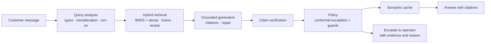

# answerdesk

**Grounded, multilingual customer-support RAG with verified citations and calibrated escalation.**
A reference implementation — not another demo. Every displayed sentence is backed by retrieved
evidence, the system abstains when evidence is insufficient, and the quality numbers come with
confidence intervals and committed artifacts.

> **Status: v0.1.0 in progress.** The service, evaluation harness and operator console work
> offline; design documents are in [`docs/`](docs), and the first live evidence package
> (including a negative calibration result) is in [`docs/results.md`](docs/results.md).
> The live-risk claim is not met yet — see *Honest limitations* below.

## Why this exists

An LLM support bot is only trustworthy when three things are true, and most open-source RAG
demos do none of them:

1. **Every claim is verified against the retrieved passage** — not just decorated with a link.
   Citations are checked by an entailment/lexical verifier; unsupported claims are dropped or
   the turn is escalated.
2. **The system knows when it does not know.** A split-conformal threshold with a cost model
   turns "answer vs escalate" into a risk-controlled decision, evaluated in both directions
   (must-escalate recall and false-escalation rate).
3. **Quality is measured, not asserted.** Frozen splits, document-level leakage checks,
   paired bootstrap and McNemar tests, judged metrics from a *different model family* than the
   generator, and calibration artifacts (ECE, risk–coverage) next to every number.

## What is inside

- **Ingestion** — PDF/DOCX/HTML/Markdown loaders, structure-aware chunking (headings, tables,
  FAQ pairs), MinHash dedup, canonical tokens for dates/amounts/card numbers.
- **Retrieval** — BM25 + dense hybrid with RRF and calibrated convex fusion, query analysis for
  typos/transliteration/telegraphic and run-on text, optional cross-encoder reranking and MMR.
- **Generation** — one OpenAI-compatible provider layer for API and local servers (vLLM,
  llama.cpp, Ollama), strict JSON output, cost/latency ledger, citation enforcement and a
  repair pass.
- **Policy** — split-conformal escalation with a cost-sensitive decision rule, PII/injection
  guards, and a semantically cached answer path with a calibrated wrong-hit budget.
- **Service & console** — FastAPI + SSE, SQLite sessions, JSONL traces, Prometheus metrics,
  and a React operator console with citations, diagnostics and analytics.
- **Evaluation** — synthetic multilingual corpus (ru, uz, tg, ky, zh, tr), `answerdesk-bench`
  (Belebele-derived retrieval, Mr. TyDi ru, a domain slice), and reproducible ablations.

## Architecture



## Quickstart (offline, no API key)

```bash
uv sync --extra dev
uv run answerdesk ingest --demo          # build the 6-locale synthetic corpus
uv run answerdesk index --demo           # BM25 + hashing-dense index
uv run answerdesk eval --synthetic --provider fake --report reports/offline-smoke
uv run --extra api answerdesk serve --fake --port 8765 --healthcheck
```

Point it at a real model (API or a local server) by copying `.env.example` to `.env` and
selecting a provider preset — see [`docs/generation.md`](docs/generation.md). The same pipeline
runs against `vLLM`, `llama.cpp` or `Ollama` with no code change.

## Datasets

- **Synthetic support corpus** — 810 documents, 7,229 chunks, 3,240 grounded queries across six
  locales; deterministic builder, every reference answer verified against its document.
  License: CC0-1.0. See [`docs/ingestion.md`](docs/ingestion.md).
- **`answerdesk-bench` v0.1** — 4,109 items: Belebele-derived retrieval with qrels for
  ru/uz/tg/ky/zh, Mr. TyDi ru native qrels, and a domain slice with unanswerable/PII/injection
  cases. Licenses are separated per source; see
  [`data/bench/answerdesk-bench/v0.1/DATASET_CARD.md`](data/bench/answerdesk-bench/v0.1/DATASET_CARD.md).

## Honest limitations

- **Risk control did not hold in the first live study.** With `qwen3.6-35b-a3b-noreason`, the
  decision-time overlap signal saturated (p=1.0 on most answered turns), the conformal
  threshold degenerated, and realised risk on answered turns was 22.3% against a 5% target.
  A logistic scorer fitted on dev improved calibration (ECE 0.343 → 0.079) but still failed the
  gate (risk 0.410, Wilson UCB 0.446; the dev-selected 2% operating point was infeasible).
  Calibration machinery works; the signal/answer quality does not yet support a risk guarantee.
  See [`docs/results.md`](docs/results.md).
- The synthetic corpus is lexically easy — BM25 already scores ≈1.0 recall on it, and
  structure-aware chunking did not improve recall over naive windows in the ablation. It proves
  the machinery, not the domain; external validity comes from `answerdesk-bench`.
- A local query-rewriter LoRA was trained and measured, and **did not help** (clean-query
  regression) — it ships disabled, with the negative result documented in
  [`docs/query-rewriter.md`](docs/query-rewriter.md).
- The secondary DeepSeek arm used a schema-fallback path (the provider rejects strict
  `json_schema`), so it is labelled *not directly comparable* rather than reported as a model
  quality gap.
- Content is synthetic and LLM-assisted; scripts, terminology, formats and grounding are
  tested, native-speaker fluency is not.

## Repository map

| Path | What |
| --- | --- |
| `src/answerdesk/` | ingestion, retrieval, generation, policy, cache, service, telemetry, eval |
| `web/` | operator console (React + Vite, mock mode, Playwright screenshots) |
| `docs/` | requirements, architecture, ADRs, API/ops, eval methodology, robustness, load |
| `data/corpus/` | frozen synthetic corpus + queries |
| `data/bench/` | curated `answerdesk-bench` release |
| `evals/` | golden sets, splits, adversarial sets, judge rubric |
| `tests/` | unit, integration, property/fuzz and load suites (offline) |

## License

Code is MIT. The synthetic corpus is CC0-1.0. Benchmark data keeps its upstream licenses
(CC BY-SA 4.0 / Apache-2.0 / CC0-1.0) and is separated from the MIT code — see the dataset card.
