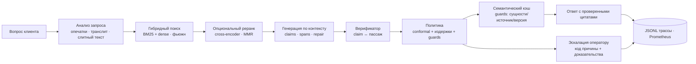

# answerdesk

**Многоязычный RAG для поддержки клиентов, который показывает свою работу: проверенные цитаты,
калиброванное решение «ответить / эскалировать» и цифры с доверительными интервалами и
закоммиченными артефактами.**

Это референсная реализация, а не демо. Каждое показанное предложение опирается на найденный
фрагмент и проверяется верификатором; система отказывается отвечать вместо того, чтобы угадывать;
метрики поиска, качества ответа, эскалации, кэша, задержек и стоимости воспроизводятся одной
командой на ноутбуке — без Docker, без векторной БД и без API-ключа для офлайн-режима.

`Python 3.11–3.13` · `MIT (код) · CC0-1.0 (синтетический корпус)` · `Windows / Linux / macOS` ·
`local-first, API по выбору (OpenAI-совместимые: vLLM, llama.cpp, Ollama)`

> **Честный статус (v0.1.0).** Пайплайн, сервис, консоль и харнесс оценки работают end-to-end и
> офлайн. Первое живое исследование дало **отрицательный результат по контролю риска**: с
> поставляемым сигналом уверенности (overlap) фактический риск на отвеченных ходах составил 22.3%
> при цели 5%. Этот результат опубликован в [`docs/results.md`](docs/results.md), и ничто в
> репозитории не утверждает обратного. Что действительно показано: заземлённые ответы с
> проверенными цитатами, must-escalate recall 1.00 (0 пропусков из 24 небезопасных кейсов),
> воспроизводимая цепочка измерений и рост понимания на публичных бенчмарках в четырёх языках из
> пяти.

---

## Зачем это нужно

Open-source RAG-демо делается быстро, а доверять ему трудно. В поддержке клиентов важны три
свойства, и у большинства проектов нет ни одного:

1. **Цитаты — не украшение.** Здесь цитата — это span в конкретном фрагменте, она обязана
   разрешаться в пассаж, который реально был в контексте, и проверяется верификатором; неподтверждённые
   утверждения отбрасываются или ход эскалируется (`INV-02`, `INV-03`).
2. **Система знает, когда она не знает.** Здесь решение принимает split-conformal квантиль вместе с
   моделью издержек, и измеряются обе ошибки: must-escalate recall и доля ложных эскалаций.
3. **Цифры измерены, а не заявлены.** Каждая таблица в [`docs/results.md`](docs/results.md)
   генерируется из закоммиченных артефактов скриптом [`scripts/build-results.py`](scripts/build-results.py):
   замороженные хэшированные сплиты, проверка утечки на уровне документов, paired bootstrap и
   McNemar, судья из другого семейства моделей, чем генератор.

Репозиторий также явно фиксирует, чего он **не** утверждает: нет человеческой κ, нет прод-трафика,
нет SOTA-ранжирования — см. раздел «Ограничения».

---

## Архитектура



Полная схема компонентов — [`docs/architecture.md`](docs/architecture.md), отрендеренная копия —
[`docs/assets/architecture.svg`](docs/assets/architecture.svg), 13 ADR — в
[`docs/design-decisions.md`](docs/design-decisions.md).

Шесть языков первого класса: **ru, uz, tg, ky, tr, zh**. Генератор отвечает на языке запроса;
корпус, golden-наборы и все метрики — по языкам.

---

## Быстрый старт — офлайн, без API-ключа

Нужны только [uv](https://docs.astral.sh/uv/) и Python 3.11+ (uv умеет скачать Python сам).
Ни Docker, ни сервера БД, ни весов моделей для этого пути.

```bash
git clone <your-fork> answerdesk && cd answerdesk
uv sync --extra dev                       # база + инструменты тестов/линта (без torch)
uv run answerdesk ingest --demo           # синтетический корпус на 6 языках (~8 с)
uv run answerdesk index --demo            # индекс BM25 + точный dense (~1 с)
uv run answerdesk ask --fake "Сколько стоит обслуживание карты?"
uv run answerdesk eval --synthetic --provider fake --report reports/offline-smoke
```

`ask` печатает ответ с нумерованными цитатами, решение, код причины и стоимость в токенах:

```text
Q: Сколько стоит обслуживание карты?
A: Обслуживание дебетовой карты «Вектор» стоит 120 рублей в месяц. [1] Плата списывается первого числа каждого месяца. [2]
Citations:
  [1] Тарифы по карте «Вектор» — Тарифы по карте «Вектор» > Обслуживание (demo-card-fee-ru) chars 0-63
  [2] Тарифы по карте «Вектор» — Тарифы по карте «Вектор» > Обслуживание (demo-card-fee-ru) chars 64-111
Decision: answer (ANSWERED); language=ru; evidence_score=0.940; repaired=False; dropped=0
Usage: model=fake-model input=314 output=45 usd=0.00000000 prompt=grounded-answer-1.0.0 verifier=lexical-verifier-1.0.0
```

Весь офлайн-цикл одной командой (корпус → индекс → вопрос → eval → healthcheck сервиса):

```powershell
pwsh -File scripts/demo.ps1
```

> **Windows с системным прокси.** `httpx` читает настройки прокси Windows; `socks4`-прокси,
> который он не умеет, ломает создание клиента. Скрипты выставляют `NO_PROXY` для loopback; при
> ручном запуске добавляйте `$env:NO_PROXY='*'`.

## Запуск с реальной моделью

Любой OpenAI-совместимый эндпоинт работает **без изменения кода**: облачные API (OpenAI, DeepSeek,
OpenRouter) или локальный сервер (vLLM, llama.cpp, Ollama). Выбор провайдера — это конфигурация,
таблица пресетов в [`src/answerdesk/config.py`](src/answerdesk/config.py), описание — в
[`docs/generation.md`](docs/generation.md).

```bash
cp .env.example .env                      # или экспортируйте переменные
export OPENAI_API_KEY=sk-...              # либо DEEPSEEK_API_KEY / OPENROUTER_API_KEY
uv run answerdesk config check --profile api     # проверит пресет и покажет его с маскировкой
uv run answerdesk ask "Сколько идёт возврат средств по карте?" --profile api
```

Локально, без выхода данных наружу:

```bash
uv sync --extra local                     # torch + sentence-transformers (CPU достаточно)
ollama serve && ollama pull qwen3:8b      # или: vllm serve Qwen/Qwen3-8B-Instruct --port 8000
uv run answerdesk --profile local config check
uv run answerdesk --profile local ask "Сколько идёт возврат средств по карте?"
```

Установка CUDA-колёс для Windows описана в [`docs/architecture.md`](docs/architecture.md) §11.

## Консоль оператора

React-консоль превращает решение в то, что человек может контролировать: очередь, предложенный
ответ с кликабельными чипами цитат, p̂ относительно полосы ответа, код причины и панель диагностики
с кандидатами поиска, параметрами фьюжна, статусом кэша, задержками по стадиям и стоимостью.


| | |
|---|---|
|  |  |
| Цитата открывает точный фрагмент источника | Диагностика объясняет решение |
|  |  |
| Эскалация несёт код причины и тикет | Аналитика читает живую выдачу Prometheus |

```bash
cd web
npm ci
npm run dev          # http://localhost:5173 — проксирует /v1, /metrics, /healthz на сервис
npm run test         # 61 тест компонентов/интеграции, без сети
npm run build        # tsc --noEmit && vite build
```

Сервис в другом терминале:

```bash
$env:NO_PROXY='*'; uv run --extra api answerdesk serve --fake --port 8765
```

Mock-режим без бэкенда: `http://localhost:5173/?mock=1` или сборка с `VITE_USE_MOCK=true`.
Скриншоты всех шести экранов воспроизводятся командой `npm run screenshots`
(см. [`web/README.md`](web/README.md)).

---

## Что внутри

| Слой | Что делает | Подробнее |
|---|---|---|
| **Ingestion** | Загрузчики PDF/DOCX/HTML/Markdown, структурный чанкинг (заголовки, таблицы, FAQ не разрываются), MinHash-дедуп, канонические токены дат/сумм, детерминированный генератор корпуса | [`docs/ingestion.md`](docs/ingestion.md) |
| **Retrieval** | Гибрид BM25 + dense, фьюжн RRF и convex combination, анализ опечаток/транслита/слитного текста, опциональный cross-encoder и MMR | [`docs/retrieval.md`](docs/retrieval.md) |
| **Generation** | Один слой провайдеров для API и локальных серверов, строгий JSON, span-цитаты, один repair-pass, согласование языка | [`docs/generation.md`](docs/generation.md) |
| **Policy** | Split-conformal квантиль с поправкой `⌈(n+1)(1−α)⌉`, трёхстороннее правило издержек, PII- и injection-guards, монитор покрытия | [`docs/escalation.md`](docs/escalation.md) |
| **Cache** | Точный и семантический поиск с guards (сущности, документ-источник, версии), негативный кэш, бюджет неверных попаданий | [`docs/cache.md`](docs/cache.md) |
| **Service** | FastAPI + SSE (`retrieval → tokens → citations → decision → done`), SQLite-сессии и идемпотентность, JSONL-трассы, Prometheus, защищённый admin-ingest | [`docs/api.md`](docs/api.md), [`docs/ops.md`](docs/ops.md) |
| **Console** | React + Vite + TypeScript, тёмная/светлая тема, MSW mock, доступность | [`web/README.md`](web/README.md) |
| **Evaluation** | Замороженный golden-набор с adversarially-наборами, метрики поиска/ответа/эскалации/кэша, bootstrap + McNemar + Wilson, протокол калибровки судьи, аблации | [`docs/eval-methodology.md`](docs/eval-methodology.md) |
| **Robustness & load** | Находки фаззинга и исправления, устойчивость к враждебному вводу, конкурентность и утечки | [`docs/robustness.md`](docs/robustness.md), [`docs/load.md`](docs/load.md) |

### Ключевые решения

- **Гибридный поиск с измеримым фьюжном.** RRF — дефолт без разметки; настроенная convex combination —
  документированный путь, подбирается только на dev. Аблация в [`docs/results.md`](docs/results.md)
  показывает, что каждый arm реально даёт *на этом корпусе*, и честно признаёт, что BM25 доминирует на
  лексически простом синтетическом корпусе.
- **Заземлённые цитаты с проверкой.** Claim → span → дословная цитата → `doc_hash`, плюс
  детерминированный numeric-guard: число или дата в утверждении должны присутствовать в
  цитируемом фрагменте.
- **Механика калиброванной эскалации.** Split-conformal квантиль, cost-sensitive трёхстороннее
  правило, фиксированный приоритет guards (PII/injection → высокий риск → соответствие → полоса
  издержек) и гейт, объявленный до измерения: контроль риска считается выполненным только если
  верхняя граница Уилсона фактического риска ≤ α. В первом живом исследовании — не выполнено, и это
  заявлено в заголовке результатов.
- **Калиброванный кэш, а не порог по косинусу.** Попадание проходит проверку равенства сущностей,
  документа-источника и версий и перепроверяется перед показом; бюджет неверных попаданий измеряется
  на adversarially-наборе near-miss пар.
- **Универсальный слой провайдеров.** Один OpenAI-совместимый клиент; пресеты различаются только
  дефолтами, поэтому переключение между облаком и локальным сервером — правка конфигурации.
- **Детерминированная офлайн-оценка.** Без сети, ключей и GPU: тесты ставят socket-guard, который
  валит любое исходящее соединение, а `scripts/ci-offline.ps1` запускает тот же гейт, что и CI.

---

## Результаты

Все числа ниже — из [`docs/results.md`](docs/results.md) и закоммиченных артефактов в `reports/`.
Они описывают этот референсный стек **на синтетическом корпусе** (810 документов, 7 229 чанков,
3 240 заземлённых запросов на шести языках), если не указано «внешние». Интервалы — 95%.

### Аблация поиска (внутренняя, n=240 кейсов)

| arm | recall_any@10 | nDCG@10 | MRR@10 | средняя задержка |
|---|---|---|---|---|
| `bm25` | 0.996 [0.988, 1.000] | 0.934 [0.915, 0.952] | 0.984 | 1.3 мс |
| `dense` (hashing-64 по умолчанию, bge-m3 опционально) | 0.950 [0.921, 0.975] | 0.672 [0.632, 0.706] | 0.820 | 1017.7 мс |
| `rrf@60` (гибрид) | 0.992 [0.979, 1.000] | 0.856 [0.826, 0.881] | 0.957 | 2.3 мс |
| `cc@0.75` (гибрид, настроенная α) | 0.975 [0.954, 0.992] | 0.809 [0.774, 0.840] | 0.914 | 2.4 мс |

Paired bootstrap по `recall_any@10`: `bm25 − dense` = **+0.0458** [+0.0208, +0.0750], McNemar
p=0.001 — BM25 выигрывает; `bm25 − rrf@60` = +0.0042 [0.0000, +0.0125], p=1.0 — **утверждения нет**.
На этом корпусе текст лексически простой, гибриду нечего добавить; аблация — это доказательство, и
ограничение сформулировано, а не спрятано.

### Качество ответа и эскалация (primary arm: генератор `qwen3.6-35b-a3b-noreason`, судья из другого семейства)

| метрика | значение (95% CI, n) | как читать |
|---|---|---|
| groundedness (judged, поддержка утверждений) | 0.908 [0.858, 0.950] (n=141) | 9 из 10 показанных утверждений признаны поддержанными |
| rubric score (1–5, pass ≥ 4) | 4.692 [4.576, 4.790] (n=141) | judged, с оговоркой про κ |
| citation recall (ALCE-style) | 0.211 [0.189, 0.233] (n=141) | **слабое место**: у многих утверждений нет цитаты, полностью их поддерживающей |
| citation precision | 0.671 [0.610, 0.727] (n=141) | две трети цитат поддерживают своё утверждение |
| language agreement | 0.986 [0.952, 0.996] (n=148) | ответ на языке запроса |
| auto-answer coverage | 0.841 [0.780, 0.888] (n=176) | 84% ходов отвечено без человека |
| must-escalate recall | 1.000 [0.862, 1.000] (n=24) | 0 пропусков на небезопасных/безответных ходах |
| escalation precision | 0.462 [0.333, 0.595] (n=52) | ~16% отвечаемых ходов эскалированы (false-escalation 0.159) |
| **фактический риск на отвеченных** | **0.223 [0.163, 0.297] (n=148)** | **против α = 0.05 — контроль риска не выполнен** |

Вердикт калибровки одной строкой: сигнал уверенности (overlap) насыщается в `p=1.0` для 74%
запросов, conformal-квантиль схлопывается в ноль, и порог почти ничего не разделяет. Логистический
скоринг, обученный на dev, улучшил калибровку (ECE 0.343 → 0.079), но не дал дискриминативной силы
(риск 0.410, Wilson UCB 0.446 > α). Оба результата — в [`docs/results.md`](docs/results.md);
репозиторий **не содержит утверждения о контроле риска**.

Кэш на near-miss парах: **0 попаданий из 28 попыток** — guards отклонили все near-miss, поэтому
доля неверных попаданий 0.0 (UCB 0.0), а hit rate 0.0 [0.000, 0.121]. Это честный ноль: guards
консервативны, для hit rate нужен реальный трафик.

### Внешняя валидность (публичные бенчмарки, без LLM-судьи)

| бенчмарк | метрика | до | после (с RAG) | Δ [95% CI] | утверждение |
|---|---|---|---|---|---|
| Belebele ru (n=120) | точность понимания | 0.583 | 0.850 | +0.267 [+0.175, +0.358] | да |
| Belebele uz (n=120) | точность понимания | 0.542 | 0.775 | +0.233 [+0.133, +0.333] | да |
| Belebele tg (n=120) | точность понимания | 0.533 | 0.792 | +0.258 [+0.158, +0.358] | да |
| Belebele ky (n=120) | точность понимания | 0.458 | 0.742 | +0.283 [+0.175, +0.391] | да |
| Belebele zh (n=120) | точность понимания | 0.700 | 0.692 | −0.008 [−0.083, +0.075] | **нет утверждения** (CI пересекает 0) |
| Mr. TyDi ru (n=994, родные qrels) | nDCG@10 | 0.604 | 0.747 | +0.1435 [+0.1290, +0.1581] | да (единственное внешнее утверждение о качестве поиска) |

Публичных qrels для поиска на узбекском, таджикском и киргизском нет, поэтому внешних утверждений о
качестве поиска для них не делается. Производные метки Belebele-retrieval — только диагностика.

### Эксплуатация (измерено, n=200 ходов)

| величина | primary arm |
|---|---|
| задержка поиска p50 / p95 | 1.44 / 2.54 мс |
| end-to-end p50 / p95 (с генерацией и судьёй) | 7748 / 55107 мс |
| токенов на отвеченный ход (вход/выход) | 3256 / 512 |
| USD на отвеченный ход | 0.0 (бесплатный тариф на момент измерения; снимок цен закоммичен) |

Медленный хвост — судья; путь поиска измеряется миллисекундами. Конкурентность (1/8/32/64 клиента)
и проверки утечек сервиса — в [`docs/load.md`](docs/load.md).

---

## Данные

| набор | что это | лицензия |
|---|---|---|
| **Синтетический корпус** (в репозитории) | 810 документов, 7 229 чанков, 3 240 заземлённых запросов на ru/uz/tg/ky/tr/zh; 12 архетипов документов; детерминированный сборщик; каждый эталонный ответ проверен по документу | CC0-1.0 |
| **`answerdesk-bench` v0.1** (в репозитории) | 4 109 элементов: Belebele-derived QA и retrieval (ru/uz/tg/ky/zh), Mr. TyDi ru с родными qrels, доменный срез с unanswerable/PII/injection; лицензии по источникам, upstream-данные не вендорятся | MIT (код), CC BY-SA 4.0 / Apache-2.0 / CC0-1.0 по источникам — см. [dataset card](data/bench/answerdesk-bench/v0.1/DATASET_CARD.md) |
| **Golden set v1 + adversarial-наборы** | замороженные хэшированные сплиты, near-miss пары кэша, claim-level метки, injection/PII/perturbation наборы, рубрика судьи | MIT / CC0-1.0 |

Приватных данных нет: ни кода, ни данных работодателя, банка или клиентов, ни реальных записей
клиентов. Синтетические идентификаторы — только из зарезервированных диапазонов (`example.com`,
RFC 5737, документированные тестовые номера карт).

---

## Воспроизведение всех чисел

```bash
uv sync --extra dev
pwsh -File scripts/ci-offline.ps1          # офлайн-гейт: линт, типы, весь офлайн-набор (1200+ тестов), без сети
uv run answerdesk eval --synthetic --provider fake --report reports/offline-smoke   # ~12 с
uv run answerdesk eval --all --provider api --report reports/bench                 # живые данные
uv run python scripts/build-results.py --run reports/bench --out docs/results.md --check
```

- Детерминизм: корпус, golden-набор, сплит и артефакты калибровки хэшируются и печатаются в шапке
  каждого отчёта; `scripts/build-results.py --check` падает, если `docs/results.md` устарел.
- Живые прогоны требуют ключей провайдеров; без них харнесс работает в явно помеченном replay-режиме,
  и живые числа не выдумываются. Настройка провайдеров — `scripts/live-env.ps1`.
- Полный протокол, железо и матрица сбоев: [`docs/reproducibility.md`](docs/reproducibility.md).

---

## Карта репозитория

| Путь | Что там |
|---|---|
| `src/answerdesk/` | `ingest` · `index` · `retrieval` · `rewrite` (экспериментально, отключено) · `rerank` · `generate` · `llm` · `policy` · `cache` · `service` · `telemetry` · `eval` · `testing` |
| `src/answerdesk/contracts.py` | замороженные межмодульные типы и `Protocol`-швы (schema 1.0.0) |
| `web/` | консоль оператора (React + Vite + TypeScript, MSW mock, Playwright-скриншоты) |
| `docs/` | [требования](docs/requirements.md) · [архитектура](docs/architecture.md) · [ADR](docs/design-decisions.md) · [математика](docs/math.md) · методология · API/ops · результаты · аудит |
| `data/corpus/` | замороженный синтетический корпус, запросы, манифест (CC0-1.0) |
| `data/bench/` | релиз `answerdesk-bench` с лицензиями по источникам |
| `evals/` | golden set v1, сплиты, adversarial-наборы, рубрика судьи |
| `scripts/` | демо, офлайн-гейт, бенчмарк, калибровка, сборка результатов, внешний arm, нагрузка |
| `tests/` | unit · integration · property/fuzz · load · smoke (офлайн, 1200+ тестов) |
| `.github/workflows/ci.yml` | быстрый и полный гейты на Linux и Windows, без секретов и сети |

---

## Ограничения (что не обобщается)

1. **Синтетический корпус.** 810 сгенерированных документов; запросы выводятся из тех же документов,
   поэтому поиск и groundedness оптимистичны относительно реального трафика. Ни одно число не
   переносится без переизмерения на продуктовом корпусе.
2. **Контроль риска не выполнен.** Фактический риск на отвеченных ходах — 22.3% (цель 5%) в первом
   живом исследовании; калиброванный логистический скоринг улучшил ECE, но не риск. Это не
   distribution-free гарантия на данных доказательствах.
3. **Judged-метрики диагностические.** Человеческой κ в этом чекауте нет: 150-элементные листы на
   язык и протокол слепой двойной разметки поставляются в `evals/`, но пока κ ≥ 0.6 не установлена,
   ни одно judged-число не является релизным гейтом.
4. **Citation recall низкий (0.211).** Верификатор принимает утверждения с частичной поддержкой;
   многие утверждения не покрыты цитатой полностью. Это заявлено как слабое место.
5. **Нет реального банковского трафика, SLA и истории инцидентов.** Соотношения издержек эскалации —
   документированные допущения; стоимость передачи человеку не измерялась.
6. **Кэш не был нагружен.** Ноль near-miss попаданий означает, что у бюджета неверных попаданий пока
   нет положительного доказательства; нужен реальный трафик.
7. **Объём аблаций.** Варианты чанкинга и кэш on/off приведены там, где есть артефакты; не все
   комбинации фьюзеров/нормализаций прогнаны, arm с реранкером мал (n=80).
8. **Внешняя валидность — отдельный отчёт.** Публичные бенчмарки отвечают на другой вопрос на других
   данных; они никогда не сливаются с внутренними таблицами.
9. **Дрейф провайдеров.** Модели и цены меняются; прогон фиксирует id моделей, токены и дату снимка
   цен. Вторичный arm DeepSeek шёл через schema-fallback и помечен как *несопоставимый напрямую*.
10. **LoRA-переписчик запросов не помог** (регрессия на чистых запросах). Он поставляется отключённым,
    отрицательный результат — в [`docs/query-rewriter.md`](docs/query-rewriter.md).
11. **Контент сгенерирован с помощью LLM.** Скрипты, терминология, форматы и заземление проверены;
    естественность речи носителей — нет.

---

## Дорожная карта

- **Человеческая κ на judged-метриках** — заполнить листы, провести арбитраж, опубликовать κ по
  языкам; только после этого F-1/F-2/F-3 могут стать гейтами.
- **Контроль риска, который выполняется** — сигнал answerability с реальной дискриминативной силой
  (NLI/entailment-скоринг или калиброванный судья), проверенный по заранее объявленному Wilson-UCB
  гейту на отложенных данных.
- **Пилот на реальном трафике** — hit rate кэша, стоимость эскалации и мониторинг дрейфа; это то, что
  превращает синтетические числа в утверждения.
- **Лексический поиск с учётом CJK** — китайскому BM25 нужна сегментация; внешняя диагностика
  показывает разрыв.
- **Реранкер на полном наборе** вместо n=80.
- **Learned fusion** — больше, чем одна α, с аблацией в харнессе.
- **Паритет Qdrant-адаптера** — доказать идентичный порядок относительно точного numpy-индекса.
- **Side study reasoning-варианта** при наличии квоты (`scripts/reasoning-side-study.py`).

Явные не-цели (без изменений): голос/телефония, коннекторы к тикет-системам и мессенджерам,
автономные действия по счетам клиентов, мультитенантный SaaS-identity, файнтюнинг генераторов и
любая история про деплой. См. требования §12.

---

## Участие

Issues и PR приветствуются. Сначала прочитайте [`CONTRIBUTING.md`](CONTRIBUTING.md): там описан
офлайн-гейт, правило «каждое изменение поведения несёт ID требования и маркер `# AT-…`» и правила
честности для чисел. О проблемах безопасности — [`SECURITY.md`](SECURITY.md); ожидания сообщества —
[`CODE_OF_CONDUCT.md`](CODE_OF_CONDUCT.md).

## Цитирование

Если вы используете эту работу, цитируйте репозиторий (метаданные в [`CITATION.cff`](CITATION.cff)):

```bibtex
@software{answerdesk2026,
  title  = {answerdesk: a reproducible multilingual customer-support RAG reference stack},
  author = {{answerdesk contributors}},
  year   = {2026},
  version = {0.1.0},
  url    = {https://github.com/answerdesk/answerdesk},
  note   = {Verified citations, calibrated escalation, reproducible evaluation}
}
```

## Лицензия

Код — **MIT**. Синтетический корпус и golden-наборы — **CC0-1.0**. Данные бенчмарка сохраняют
лицензии источников (CC BY-SA 4.0 / Apache-2.0 / CC0-1.0) и отделены от MIT-кода — см.
[dataset card](data/bench/answerdesk-bench/v0.1/DATASET_CARD.md). Код и данные работодателя, банка или
клиентов не включены.
