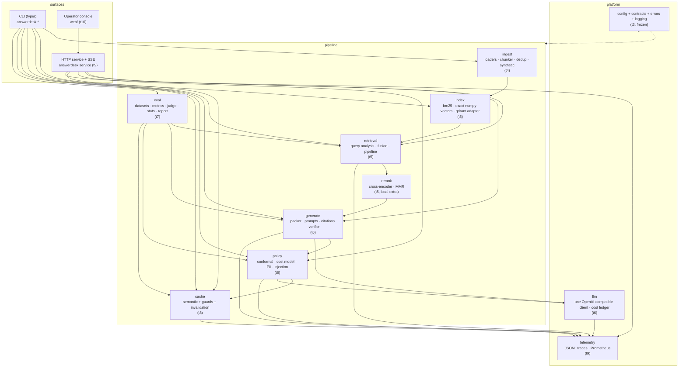
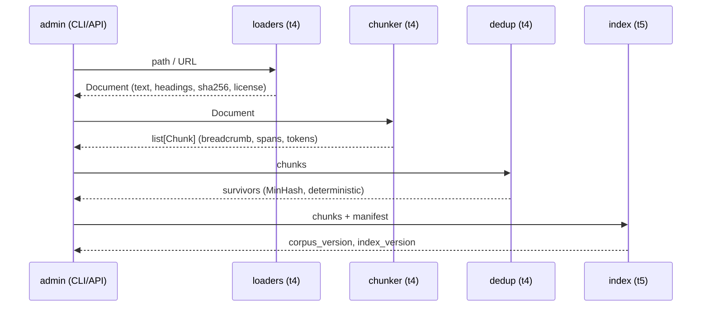
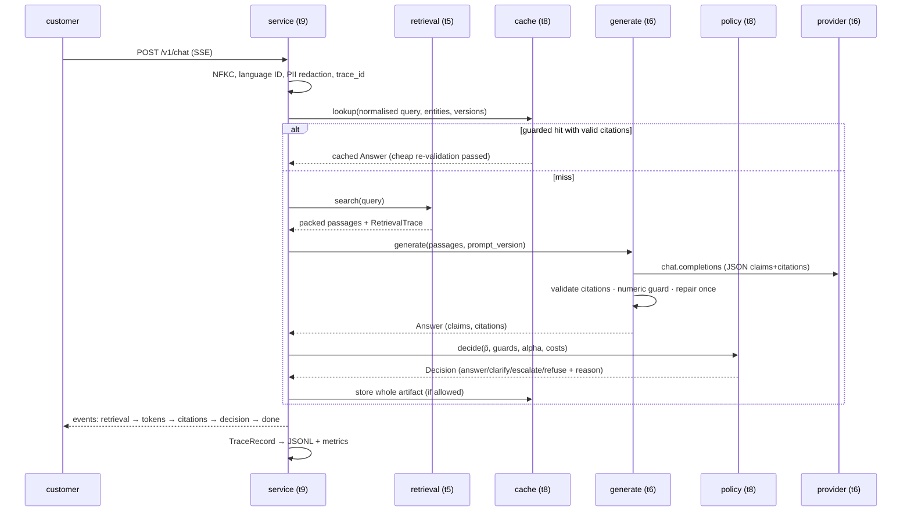

# answerdesk architecture

Status: **skeleton (t3) frozen**. This document describes the boundaries the parallel
module tasks build against; it is normative where it names a contract or an import rule.
The product contract is `docs/requirements.md` (`AD-REQ-v1.0`); the decisions behind the
boundaries are in `docs/design-decisions.md`.

Target: one machine, Windows 11 + Python 3.12, no Docker, no service dependencies. The same
commands work on Linux and macOS. Model access is OpenAI-compatible over HTTP; everything
else is local.

---

## 1. System context

```
                        ┌──────────────────────────────────────────────┐
  customer (ru/tg/uz/   │  service  (FastAPI, SSE)   console (React)   │
  ky/tr/zh)  ───────►   │  t9                        t10               │
                        └───────────────┬──────────────────────────────┘
                                        │
  admin (CLI / admin API) ──────────────┤
                                        ▼
                        ┌──────────────────────────────────────────────┐
                        │  pipeline                                    │
                        │  ingest → index → retrieve → generate →      │
                        │  verify → decide → cache → trace             │
                        └───────┬───────────────┬──────────────┬───────┘
                                │               │              │
                        provider layer     policy/cache    telemetry
                        (t6)               (t8)            (t9)
                                │
                     OpenAI-compatible HTTP: API (default) or local
                     server (vLLM / llama.cpp / Ollama)
```

Out of scope by decision: deployment, voice, connectors, multi-tenancy, autonomous actions
(`docs/requirements.md` §12).

---

## 2. Component diagram



Every arrow is a `Protocol` seam from `answerdesk.contracts` or a pydantic model; modules do
not import each other's internals.

---

## 3. Contracts (`answerdesk.contracts`)

`src/answerdesk/contracts.py` is the only home for cross-module types. Rules:

1. Models forbid unknown fields (`extra="forbid"`, ADR-006). Adding a field is a contract
   change: edit `contracts.py`, bump `SCHEMA_VERSION`, note it in the change log.
2. Models are the *persisted/displayed* shape. A module may keep private drafting
   structures locally; only validated contracts cross a seam.
3. No contract imports a heavy optional dependency and none performs I/O.

### 3.1 Models

| Model | Produced by | Consumed by | Requirement |
|---|---|---|---|
| `Document` | ingest (t4) | chunker, dedup | FR-ING-01 |
| `Heading` | ingest (t4) | chunker | FR-ING-02 |
| `Chunk` | chunker (t4) | index, retrieval, generate | FR-ING-03/04/05 |
| `RetrievedPassage` | index/retrieval/rerank (t5) | fusion, packer, policy, trace | FR-RET-03/08 |
| `FusionInfo`, `RetrievalTrace` | retrieval (t5) | console diagnostics, eval | FR-RET-08, FR-UI-04 |
| `Citation` | generate (t6) | verifier, cache, console | CR-2…CR-6 |
| `Claim` | generate (t6) | verifier, policy | CR-1, CR-7 |
| `Decision` | policy (t8) | service, console, eval | FR-ESC-03/05 |
| `EscalationDecision` | policy + service (t8/t9) | console, tickets | FR-SVC-05 |
| `Confidence` | policy (t8) | console, eval, cache | §8.1 |
| `CacheInfo` | cache (t8) | service, console | FR-CAC-04 |
| `Usage`, `PricingEntry` | llm (t6) | cost ledger, reports | NFR-COST-01/02 |
| `Provenance` | generate/service | cache invalidation, reports | FR-CAC-05, NFR-REP-02 |
| `Answer` | generate + policy | service, cache, console, eval | §7.1 (frozen shape) |
| `ProviderConfig` | config + llm (t3/t6) | provider layer | NFR-PORT-01 |
| `Message`, `Completion`, `CompletionChunk` | llm (t6) | generate, eval judge | FR-GEN-09 |
| `TraceRecord` | service (t9) | telemetry sink, console | FR-SVC-08, NFR-OBS-01 |
| `EvalCase`, `EvalProvenance` | eval (t7) | harness, splits | FR-EVL-01/02 |
| `ClaimVerification` | verifier (t6) | policy, eval | F-9 |
| `JudgeScore` | eval judge (t7) | reports | §10.5 |

### 3.2 Protocol seams

| Protocol | Implemented by | Notes |
|---|---|---|
| `Embedder` | `HashingEmbedder` (CI), BGE-M3 / Qwen3 (local) | `embed_documents`, `embed_query`, `dimension` |
| `Retriever` | BM25, exact dense, Qdrant adapter | returns `RetrievedPassage` with channel and rank |
| `FusionStrategy` | RRF, convex combination | maths in `docs/retrieval.md` (t5) |
| `Reranker` | cross-encoder (local extra) | lazy import; base install must not import torch |
| `ChatProvider` | one OpenAI-compatible client, `FakeProvider` | streaming + JSON mode + retries behind one class |
| `ClaimVerifier` | lexical / judge / NLI | `FakeVerifier` in CI |
| `Judge` | rubric judge, `FakeJudge` | judge ≠ generator, position swap (§10.5) |
| `AnswerabilityScorer` | heuristic, NLI, LLM judge | feeds conformal calibration |
| `CacheBackend` | SQLite/in-memory, optional vector store | guards live in `answerdesk.cache`, not here |
| `DocumentLoader`, `Chunker` | per-format loaders, structure-first chunker | |
| `TraceSink` | JSONL file, in-memory | one record per turn |

### 3.3 Closed enums

`Action` (answer/clarify/escalate/refuse), `ReasonCode` (16 codes, identical to
`docs/requirements.md` Appendix B — enforced by
`tests/unit/test_contracts.py::test_reason_codes_match_requirements`), `Support`,
`CacheStatus`, `Channel`, `IntentBucket`, `EvalCategory`, `Split`, `Priority`, `Role`.

---

## 4. Data flow

### 4.1 Ingest and index (admin, W3)



`corpus_version` changes on every ingest/delete; the cache is keyed on it (FR-CAC-05).

### 4.2 Query (customer chat, W1)



### 4.3 Evaluation (maintainer, W4)

```
golden/v1 (hashed) ──► pipeline with doubles (G-CI) or real models (G-REL)
                          └─► metrics (recall/nDCG/MRR, groundedness, citation P/R,
                                      risk/coverage, latency, USD)
                              └─► stats (paired bootstrap, McNemar, Wilson)
                                  └─► reports/<run>/ + docs/results.md
```

---

## 5. Module boundaries and ownership

| Package | Owner | May import | Must not import |
|---|---|---|---|
| `answerdesk.contracts`, `.config`, `.errors`, `.logging`, `.cli` | t3 (frozen) | stdlib, pydantic, typer, yaml | any module package |
| `answerdesk.ingest` | t4 | contracts, stdlib, pypdf/docx/trafilatura | retrieval, llm, service |
| `answerdesk.index` | t5 | contracts, numpy, bm25s (optional qdrant) | generate, policy, service |
| `answerdesk.retrieval` | t5 | contracts, index, query analysis | llm, service |
| `answerdesk.rerank` | t5 | contracts, torch/sentence-transformers (extra) | service |
| `answerdesk.llm` | t6 | contracts, httpx | retrieval internals, service |
| `answerdesk.generate` | t6 | contracts, llm | service, web |
| `answerdesk.policy` | t8 | contracts, numpy | service, retrieval internals |
| `answerdesk.cache` | t8 | contracts, retrieval (read-only) | service |
| `answerdesk.service` | t9 | everything public | web |
| `answerdesk.telemetry` | t9 | contracts, stdlib | pipeline internals |
| `answerdesk.eval` | t7 | contracts, pipeline public API | service, web |
| `answerdesk.testing` | t3 | contracts, stdlib | concrete modules |

Conflict-avoidance rules for five parallel streams:

1. One package per task; edits outside your package are a finding, not a commit.
2. Cross-package needs go through `contracts.py` (types) or a `Protocol` (behaviour) — never
   by importing a private helper.
3. New shared test fixtures belong in `tests/conftest.py` (t3) or `answerdesk.testing`
   (t3); ask before editing either.
4. Config keys are added to `config.py` by the owning task and mirrored in
   `configs/default.yaml` in the same change (CL-POL-01).
5. Every test carries its `# AT-xxx-nn` marker (traceability checker, t12).

---

## 6. Storage and index layout

ADR-002 records the decision; the skeleton reserves the paths:

| Concern | Default | Optional | Notes |
|---|---|---|---|
| Document/chunk/turn store | SQLite (`data/answerdesk.sqlite3`) | — | WAL mode, no server process |
| Lexical index | SQLite FTS5 over chunk text | `bm25s` in-memory index | FTS5 gives BM25 without a service |
| Dense index | exact cosine over a `numpy.float32` matrix (`data/index/vectors.npy` + ids) | Qdrant via `qdrant` extra | 3k docs ≈ 20k chunks is small enough for exact search on CPU |
| Cache entries | SQLite table keyed by version tuple | external vector store | guards in `answerdesk.cache` |
| Artifacts | `reports/<run>/`, `data/corpus/manifest.json` | — | hashes in every report header |

Exact search is not a compromise at this scale: it removes an operational dependency and
makes retrieval deterministic, which the evaluation story depends on.

---

## 7. Configuration

Precedence (highest first): **CLI overrides → environment → `.env` → `configs/*.yaml` →
code defaults**. Environment variables use the `ANSWERDESK_` prefix and `__` as the nesting
delimiter (`ANSWERDESK_LLM__PRESET=ollama`).

| Profile | Provider preset | Embedder | Rerank | Network | Use |
|---|---|---|---|---|---|
| `offline` (default) | `fake` | hashing | off | none | CI, unit/integration tests, demo |
| `api` | `openai` (or deepseek/openrouter) | configurable (real embedder required for G-REL) | optional | required | product path, release evidence |
| `local` | `ollama` (or vllm/llama_cpp) | BGE-M3 | on | localhost only | no-data-leaves-the-machine |

### 7.1 Provider matrix (ADR-003)

| Preset | Default `base_url` | Default model | Key |
|---|---|---|---|
| `openai` | `https://api.openai.com/v1` | `gpt-4o-mini` | `OPENAI_API_KEY` |
| `openai_compatible` | `http://127.0.0.1:8000/v1` | `default` | optional |
| `deepseek` | `https://api.deepseek.com/v1` | `deepseek-chat` | `DEEPSEEK_API_KEY` |
| `openrouter` | `https://openrouter.ai/api/v1` | `openai/gpt-4o-mini` | `OPENROUTER_API_KEY` |
| `vllm` | `http://127.0.0.1:8000/v1` | `Qwen/Qwen3-8B` | none |
| `llama_cpp` | `http://127.0.0.1:8080/v1` | `local-model` | none |
| `ollama` | `http://127.0.0.1:11434/v1` | `qwen3:8b` | none |
| `fake` | `memory://fake` | `fake-model` | none (CI only) |

Switching provider is a config edit; no module may branch on preset name (CL-PORT-01).
Secrets are `SecretStr` and are redacted by `Settings.redacted()`, `ProviderConfig.redacted()`
and the logging formatter.

---

## 8. Token budget

The budget is enforced by the context packer (t6) and validated by the latency/cost gates
(NFR-LAT-01, NFR-COST-02).

| Component | Budget (tokens) | Enforced by |
|---|---|---|
| System prompt + citation contract | 500–700 | prompt registry (versioned) |
| Customer turn + recent history | 200–600 | service session replay (last 3 turns) |
| Packed evidence (8–12 chunks × 250–450) | 2,000–5,000 | packer: `generate.token_budget`, `context_k_min/max` |
| Reserved for the answer | 512–1,024 | `llm.max_tokens` |
| **Total request ceiling** | **≤ 8,000** (default `generate.token_budget`) | packer hard cap |

Rules:

* The packer never exceeds the cap; it drops the lowest-ranked passage instead (recall loss is
  measured, truncation is not).
* Ordering follows lost-in-the-middle: strongest evidence first, second-strongest last
  (requirements §7.4).
* Every request records `input_tokens`, `output_tokens`, `usd` from provider usage; the ledger
  reconciles against the local tokeniser within 0.5% (NFR-COST-01).
* Cost per answer is computed from `configs/pricing.yaml`; prices are never hard-coded.

---

## 9. Observability

* **Trace**: one `TraceRecord` per turn → JSONL (`logs/trace-<date>.jsonl`), PII redacted at
  write time. Contains stage latencies, the retrieval trace, decision + reason code, cache
  status, usage and versions (FR-SVC-08).
* **Metrics** (t9): request/latency histogram/error/cache-hit-miss-wrong-hit/escalation
  counters (NFR-OBS-01).
* **Console** reads the same trace shape, so "why did the bot answer that" is answerable
  without a second data model (FR-UI-04).
* Logging: stdlib JSON formatter with `redact()` on every mapping; `trace_id` is attached by
  the service.

---

## 10. Testing strategy

| Layer | What runs | Gate |
|---|---|---|
| Unit (per package) | pure logic + contracts + doubles | G-CI |
| Integration (offline) | pipeline slices with `HashingEmbedder`, `FakeProvider`, `FakeJudge` | G-CI |
| Smoke | CLI surface, packaging, docs, CI workflow, traceability markers | G-CI |
| Evidence | `answerdesk eval --all` on the frozen split with real models | G-REL |

Determinism rules:

* no wall-clock or randomness in assertions — seeds come from `eval.seed`;
* `HashingEmbedder` uses BLAKE2b, never Python's randomised `hash()`;
* `FakeProvider` derives replies only from the last user message;
* an autouse fixture in `tests/conftest.py` **fails any test that opens a socket** — the
  "no network" claim is executable, not aspirational.

---

## 11. Local model setup (Windows, CUDA optional)

```powershell
# 1. CPU-only is the default; torch installs from PyPI wheels.
uv sync --extra local

# 2. CUDA wheels for a Windows NVIDIA GPU (cu124 example; match the driver):
uv pip install torch --index-url https://download.pytorch.org/whl/cu124

# 3. Verify:
uv run python -c "import torch; print(torch.__version__, torch.cuda.is_available())"

# 4. Point the stack at a local OpenAI-compatible server:
#    Ollama:     ollama serve ; ollama pull qwen3:8b
#    llama.cpp:  llama-server -m model.gguf --port 8080 --chat-template ... (OpenAI API mode)
#    vLLM:       vllm serve Qwen/Qwen3-8B --port 8000
uv run answerdesk --profile local config check
```

`torch`, `sentence-transformers`, `qdrant-client` and `fastapi` are **extras only**: the base
install stays light and importable on a machine without a GPU (NFR-PORT-03, tested by
`tests/smoke/test_package.py`).

---

## 12. Skeleton status

| Surface | State after t3 | Owner of the implementation |
|---|---|---|
| `contracts.py`, `config.py`, `errors.py`, `logging.py` | frozen | t3 |
| `cli.py` command surface | wired; bodies exit 2 naming the owning task | t4–t9, t14 |
| `testing/` doubles | implemented (`HashingEmbedder`, `FakeProvider`, `FakeJudge`, `FakeVerifier`, `InMemoryCache`, `InMemoryTraceSink`) | t3 |
| `configs/` defaults, profiles, pricing | present | t3; `configs/policy`, `configs/retrieval`, `configs/prompts` belong to t8/t5/t6 |
| Module packages | placeholder `__init__.py` only | t4–t9 |
| CI workflow | offline gate, Linux + Windows | t3; extended by t14 |
| Repo hygiene (`LICENSE`, `.gitignore`, `.env.example`) | present | t3 |

Repository map:

```
answerdesk/
├── pyproject.toml  uv.lock  LICENSE  .gitignore  .env.example
├── configs/            default.yaml · profiles/{offline,api,local}.yaml · pricing.yaml
├── docs/               requirements.md · architecture.md · design-decisions.md
├── scripts/            ci-offline.ps1
├── src/answerdesk/     contracts · config · errors · logging · cli · testing/
│   └── ingest index retrieval rerank llm generate policy cache service telemetry eval
├── tests/              conftest.py · unit/ · smoke/
└── .github/workflows/  ci.yml
```
